# RFC: permission-aware MCP management for Ingressi

Status: **design proposal, for maintainer discussion**. This change adds documentation only. No MCP endpoint, dependency, listener, database migration, deployment change or new permission is implemented or enabled.

Reviewed against `develop` commit `4728b9e514c41383d073cb69cf0274f838b422b8` on 18 November 2026. The [API inventory](mcp-management-api-inventory.md) covers all 246 `/api/v1` route files and their 395 exported HTTP handlers at that revision. The [acceptance plan](mcp-management-acceptance.md) defines implementation evidence still required. Counts describe the reviewed source, not implemented MCP tools or a completed runtime security audit.

## 1. Problem and recommendation

An MCP-capable assistant could help an operator inspect routing, certificate coverage, upstream health, request outcomes and configuration changes without navigating several pages or inventing ad hoc API scripts. It could answer questions such as:

- Which hosts have unhealthy upstreams or missing managed certificates?
- Did a request fail at the upstream, WAF, access list, rate limiter or another control?
- What would changing one upstream affect, and does it require approval?
- Are two explicitly configured instances equivalent within the operator's authorized scope?

Recommend an **optional, read-only-first TypeScript adapter over the supported REST API**, initially using local stdio. Keep the proxy serving path independent. Add change preparation next; add execution only after trusted approvals, atomic concurrency control and recovery semantics are demonstrated. Remote HTTP is a separate phase with its own authorization design.

Broad feature coverage means every area has a documented disposition. It does not mean giving an assistant unrestricted administrative credentials. Several operations deliberately remain human-operated even after a broad MCP integration ships.

MCP supplies a tool interface, not an LLM or a guarantee that every natural-language question can be answered. A local model requires an MCP-capable client/orchestrator with compatible tool calling. Ingressi's existing AI analyst remains a separate feature.

## 2. Existing foundations and important limits

| Existing foundation | Consequence for this design |
| --- | --- |
| [REST authentication](../../src/lib/api-auth.ts) and [token scopes](../../src/lib/api-token-scopes.ts) | Tokens act within the owner's current access intersected with scopes. Reuse that enforcement on every request. An unscoped token inherits its owner; it is unsuitable as the default adapter credential. |
| [Permission catalogue](../../src/lib/permissions.ts) | There are 29 permission areas. Built-in `user`/`viewer` roles do not automatically gain administrative read permissions. Document how to provision the necessary account/token; do not assume a built-in viewer can read everything. |
| [Access scope](../../src/lib/access-scope.ts) | Tag scoping applies to proxy hosts, L4 hosts and certificates. Analytics, WAF and several other areas are instance-wide. Adding a host filter is not a new authorization boundary. |
| [Host models](../../src/lib/models/proxy-hosts.ts) | Successful host writes can apply Caddy configuration immediately. An MCP tool must never describe a live write as a draft. Rejected applies and stored-but-not-live failures need distinct handling. |
| [Host preview](../../app/api/v1/proxy-hosts/preview/route.ts) and [update preview](../../app/api/v1/proxy-hosts/[id]/preview/route.ts) | Existing POST previews can describe field changes, impact and approval requirements without saving. They require `proxy_hosts:write`; a read-only token cannot call them by assumption. Preview is not a promise of successful deployment or business compatibility. |
| [Change approvals](../../ee/docs/change-approvals.md) | Protected host changes may return HTTP 202 pending approval. Approval policies, request fingerprints and windows must remain effective. Policies do not constitute universal approval coverage for every setting/API. |
| [Certificate serialization](../../src/lib/certificate-api.ts) | Ordinary certificate responses already exclude private keys. Preserve that allowlist and use a smaller metadata projection for MCP; never weaken existing serialization. |
| [Configuration export](../../app/api/v1/config/export/route.ts) | Configuration export is secret-bearing. A read-like user request such as “show configuration” must not invoke it. |
| [Project license](../../LICENSE) and [enterprise license](../../ee/LICENSE) | Core and enterprise code have different licenses. Do not relocate enterprise implementations or bypass feature/authorization gates through MCP. Keep licensed integrations separately reviewed. |

Some permissions authorize multiple types of behavior: `approvals:read`, for example, also permits commenting and cancellation of one's own requests through selected routes. Neither a `:read` suffix nor GET/POST alone determines whether a tool is safe or side-effect-free. Review each operation and output schema.

Issue/PR keyword searches and a source search at the reviewed revision found no dedicated MCP implementation/proposal. Dependency-bump mentions of MCP are not evidence of an Ingressi MCP server. Maintainers may have unpublished plans; ask before implementing a broad feature.

## 3. Architecture and alternatives

```mermaid
flowchart LR
    H[Operator and MCP client] -->|stdio: initial release| M[Optional Ingressi MCP adapter]
    M --> P[Typed tool and output policy]
    P -->|fixed configured origin; scoped credential| R[Supported Ingressi REST API]
    R --> A[Current account, scopes, host scope and approvals]
    A --> S[Existing service and model layer]
    S --> D[Caddy, application state and analytics]
```



The adapter has no Docker socket, Caddy admin socket, database connection, privileged capability, host-network namespace or filesystem mount containing application state. An MCP outage should leave reverse proxy traffic and the dashboard operational. Stop/revoke the adapter to disable MCP without rolling back Ingressi or changing serving ports.

| Option | Benefit | Cost / decision |
| --- | --- | --- |
| Separate adapter over REST | Reuses authentication/validation, small serving-path impact, independently disabled and released | Requires capability/version mapping; adds a service/process. **Recommended first implementation.** |
| Embedded Next.js MCP endpoint | Can share authenticated request context and existing deployment | Adds remote exposure, transport lifecycle and framework compatibility requirements. Consider after the remote-auth design is accepted. |
| Direct model/database/Caddy calls | Avoids a network hop | Duplicates or bypasses scope, approvals, validation and apply recovery. Excluded. |
| Generate tools from every OpenAPI operation | Broad initial coverage | Includes secret-bearing and destructive endpoints, poor output limits and misleading safety classifications. Use OpenAPI for coverage and contract checks, with a curated registry. |

Do not call the application process through shell commands. Do not add generic `http_request`, `exec`, `sql`, file-read or arbitrary Caddy JSON tools. A fixed registry maps typed operations to reviewed methods, paths, permission requirements and response projections.

## 4. Full feature-area coverage

Phases: **A** = initial bounded reads; **B** = preparation/preview; **C** = later guarded mutations; **H** = retained human workflow. Phases are proposal boundaries, not delivered functionality. “Metadata” always means an explicit safe field allowlist. The REST API remains authoritative for permissions and edition availability.

| Area / permission family | Read / preparation scope | Mutations and limits |
| --- | --- | --- |
| HTTP hosts: `proxy_hosts` | A: list/get safe routing metadata and existing upstream health; B: typed create/update previews | C: narrowly allowed host fields; preserve host scope and approvals. Arbitrary handler JSON and security-bypass fields excluded initially. |
| L4 hosts: `l4_proxy_hosts` | Later metadata and listening-port impact | C/H: listener changes require separate port-conflict and rollback review; never inherit HTTP-host approval implicitly. |
| Certificates, CA/client certificates, mTLS: `certificates` | A: metadata, managed-vs-imported coverage, expiry and incomplete coverage | C/H: issuance, revoke/delete, import, trust changes and key-bearing input require separate design. No private-key retrieval. |
| Access lists and blocked sources: `access_lists` | Later rule summaries with sensitive identities redacted | C: bounded explicitly approved changes with scope and expiry; shared-IP impact review. H: credential lifecycle. No automatic bans from model conclusions. |
| Forward auth and groups: `groups`, host access routes | Later safe membership/access summaries | C/H: grants can expose applications; keep group/host permissions and tag scope. Never return session cookies or authentication secrets. |
| WAF: `waf` | A: bounded events/explanations, configured modes and exclusion metadata | B/C: narrowly scoped exclusion proposals; no automatic suppression, mode weakening, CRS/paranoia changes or remediation in A. |
| Analytics and saved views: `analytics` | A: deterministic bounded queries and exact-range aggregates; later saved-view metadata | C: saving/deleting a question is a mutation even if it uses an analytics permission. No arbitrary SQL or unrestricted raw-log dump. |
| Users / custom roles: `users` | Later minimized account/role metadata only | H initially: account creation, role escalation, MFA reset and session revocation. Account/token self-service endpoints remain excluded. |
| Audit: `audit_log` | Later bounded authorized event summaries and verification status | No whole audit export to model context by default. Preserve actor identity and chain verification. |
| Global configuration: `settings` | Later individually reviewed nonsecret settings and setup status | B/C: one approved settings group at a time; exclude raw settings passthrough and secret values. |
| Instances and synchronization: `instances` | Later sanitized topology/mode/status | H initially: trust pins, sync credentials and push/sync. These can affect other instances and distribute secrets. |
| Fleet: `fleet` | Later drift/revision/environment metadata within actual access | B/C: explicit promotion/rollback plan with intended instance set; H: replica credentials. Default adapter has no fleet promotion permissions. |
| High availability: `high_availability` | Later sanitized storage/replication/leader state | H initially: Redis/storage credentials, shared key storage changes, storage tests and failover; separate correctness review. |
| API documentation: `api_docs` | Build-time reviewed schema/version compatibility | Schema discovery never automatically grants tool registration or invocation. |
| Full config transfer: `config` | Metadata-only descriptions of backup/export workflows | H: export/import/replace. Secret-bearing export never becomes a general read tool. |
| Alerts: `alerts` | Later redacted channel/rule/delivery-history metadata | C/H: silence/create/update/delete; tests send real messages and need an explicit send operation. No automatic test notifications. |
| Existing AI: `ai` | Later provider/model/configured status and bounded digest preview; optional question interpretation with explicit data-egress policy | H: provider secret changes. Sending a digest and invoking a provider are distinct from reading metadata. Model output never grants write authority. |
| Audit streaming: `audit_streaming` | Later destination type, status and retention metadata | H initially: endpoint/credential changes and sink tests, which can send information externally. |
| Config history: `config_history` | Later redacted diff/history metadata | H initially: restore/rollback. Snapshots may contain secrets; never return the complete snapshot. |
| Scheduled backups: `backups` | Later status/schedule/destination metadata and verification receipts | H initially: credentials, run/test/restore/delete. A successful backup run is not proof of restore correctness. |
| SSO/OAuth/SAML: `sso` | Later provider enabled/configured metadata | H initially: trust, keys, callback and enforced-sign-in changes; prevent administrative lockout. |
| MFA policy: `mfa_policy` | Later policy metadata | H initially: policy changes and resets; no recovery codes, passkeys or session material. |
| Approvals: `approvals` | B: approved safe request/decision/window metadata | H: approve, emergency, policy management and apply. A requesting MCP identity cannot self-approve or disable its controls. |
| Compliance: `compliance` | Later authorized minimized coverage/control/report metadata | C/H: report scheduling and incident records may have legal/notification consequences. No filing or external notification by default. |
| LDAP/AD: `ldap` | Later configured status and redacted mappings | H initially: bind secrets, endpoints and sign-in tests. No credential testing through a generic “read” tool. |
| SCIM: `scim` | Later configured state and provisioning metadata | H initially: tokens, directory mappings and provisioning writes; no token issuance through model context. |
| Access reviews: `access_reviews` | Later minimized campaign/status metadata | H initially: decisions and campaigns; an assistant must not certify access on behalf of a reviewer. |
| Monetization: `monetization` | Later redacted plan/ledger aggregates only | H: consumer keys, balances, payments and Stripe credentials. Read permission can still expose sensitive billing data. |
| Branding: `branding` | Later public presentation metadata | C/H: typed presentation changes; exclude arbitrary remote-fetch/HTML/script inputs and sign-in trust changes initially. |
| Software updates, OS/Docker lifecycle | Show externally supplied version/support evidence only if a reviewed API exists | H: updates, host firewall, container lifecycle, volumes, DNS/NAT and production-port cutover are not generic MCP management tools. |
| External CrowdSec/bouncers/AppSec | Explicitly report unsupported unless a separately authorized adapter exists | No assumed native control plane; no Docker/log/identity sharing, ban injection or host-wide firewall access. Independent products need independent credentials and design. |

Host subfeatures—websockets, TLS redirects, HSTS, upstream Host preservation, load balancing/health checks, DNS resolution, mTLS/forward-auth access, rewrites, redirects, path access rules, limits, error pages and per-host WAF—belong in typed per-host schemas and coverage tests. A host-list tool returning metadata does not implement all these subfeatures for writing.

## 5. Initial tool contract

The following names are proposed, not existing commands. Start with a small deterministic list; separate side-effecting operations from reads. Do not advertise inaccessible tools and also enforce authorization on invocation, including direct calls to hidden names.

| Proposed tool | Existing REST source | Required permission / behavior |
| --- | --- | --- |
| `ingressi_hosts_list` | `GET /api/v1/proxy-hosts` | `proxy_hosts:read`; safe metadata, bounded pagination in adapter if necessary; never dump a full oversized response into context |
| `ingressi_hosts_get` | `GET /api/v1/proxy-hosts/{id}` | `proxy_hosts:read`; preserve 404 for out-of-scope IDs |
| `ingressi_hosts_health` | `GET /api/v1/proxy-hosts/{id}/health` | `proxy_hosts:read`; existing Caddy health state, not an arbitrary URL probe |
| `ingressi_certificates_overview` | `GET /api/v1/certificates/overview` | `certificates:read`; safe metadata, retain scope and distinguish management failure from certificate absence |
| `ingressi_certificates_list` | `GET /api/v1/certificates` | `certificates:read`; names/domains/type/expiry availability/configuration, no PEM by default |
| `ingressi_traffic_query` | `GET /api/v1/analytics/query` | `analytics:read`; typed dimensions/filters and exact range, instance-wide data warning |
| `ingressi_requests_list` | `GET /api/v1/analytics/requests` | `analytics:read`; opt-in detailed data policy, bounded projection and redacted URL/query fields |
| `ingressi_waf_events` | `GET /api/v1/waf/events` | `waf:read`; bounded UTC range, per-request IDs and minimized fields |
| `ingressi_waf_explain` | `GET /api/v1/waf/events/{id}/explain` | `waf:read`; redact matched payload/cookies/header values; no raw audit transaction by default |

Inspect each endpoint's actual response and query schema during implementation; the table is not a generated executable mapping. Do not use the security-rules aggregate endpoint as a substitute for arbitrary WAF-only analytics when its supported filters differ. Add a capability only when its semantics and permission behavior are demonstrated.

Phase B may add `ingressi_host_change_prepare` using existing host previews. It explicitly needs write permission for preview and can be disabled independently. It returns a proposed field diff, impact, native approval requirements, validation limitations and expiry. It does not write a host or assert that any unverified certificate, upstream or business workflow works.

Phase A should not require an AI provider key, write permission, Docker access, a new database table or any change in proxy behavior. Its “read-only” property excludes configuration changes and external notifications; authentication counters, request/audit logs and bounded query costs may still change.

Start with tools only. Later MCP resources could expose bounded, authorized status views through an adapter-owned URI namespace; resource reads/templates must enforce the same credential, field and instance boundaries as tools, with no arbitrary HTTP/file retrieval. Optional diagnostic prompt templates can help users compare routing and security evidence, but cannot approve a change. Do not advertise filesystem roots, model sampling, elicitation, subscriptions or background tasks until there is a specific reviewed requirement and protocol/client test coverage. A read resource or prompt must not become a second unguarded API surface.

## 6. Common data and error contract

Each tool has closed, typed input/output schemas and an explicit field projection. Reject unknown fields, oversized nested inputs, invalid IDs, excessive page sizes and unsupported filters. Prefer distinct create/update/enable/disable/delete operations over a broad action dispatcher.

Set the pinned SDK's read-only/destructive/idempotency annotations truthfully where applicable, and validate structured results against the output schema. Annotations are advisory metadata, not authorization or proof of rollback safety. For HTTP, do not mirror sensitive tool arguments into protocol routing headers; validate any supported header/body consistency requirements rather than trusting one representation independently.

Suggested result envelope (illustrative, not a REST change):

```json
{
  "instance": "configured-instance-alias",
  "operation": "hosts.get",
  "observedAt": "2026-11-18T10:00:00Z",
  "data": {},
  "evidence": { "source": "rest", "requestId": "opaque-correlation-id" },
  "warnings": [],
  "truncated": false,
  "nextCursor": null
}
```

Do not invent evidence IDs unavailable from the backend. An adapter correlation ID is not a Caddy request ID or Coraza transaction ID. Label them separately. If the REST result lacks a supported total, version, timestamp or truncation signal, return unknown rather than fabricating it.

Distinguish authentication failure, permission failure, out-of-scope/not-found, validation failure, pending approval, version conflict, unavailable backend, timeout, rejected configuration and uncertain write outcome. HTTP 202 is pending, not applied. A502 or timeout after a write may need readback and operator review; it is not proof that nothing changed. Return a sanitized error and correlation ID without stack traces, credentials or raw backend configuration.

Proposed conservative defaults for implementation benchmarking: 100 rows per page, max500; 24-hour detailed-request default range and7-day aggregate default, configurable hard bounds; 1MiB maximum upstream response; 4 concurrent upstream calls per adapter; 10-second read timeout; no automatic mutation retry. These are proposed limits, not claims about current REST defaults or proven capacity. Exceeding the upstream size cap fails explicitly instead of implying a complete result. Bound parsed structures as well as byte size.

## 7. Authentication, authorization and transport

### Local stdio first

Use the official TypeScript SDK and supported APIs; lock exact reviewed versions in the implementation. As reviewed, the official SDK's stable v2 line implements MCP revision 2026-07-28. Do not copy an old v1 import/transport example without verifying compatibility. Retain compatibility only for explicitly tested client/protocol pairs.

The operator configures a fixed API origin and a dedicated scoped token out of band. Prefer a protected credential file/secret mount supported by the adapter; the standard stdio environment mechanism may also carry credential configuration, with inherited-process exposure documented. Never put credentials in tool arguments, prompts, generated client JSON, command-line arguments, checked-in files or logs. Do not reuse an interactive administrator password/session.

Account permissions, scoped token permissions, deployment policy and each tool's operation allowlist must all allow a call. The REST API re-evaluates access. Scope changes/revocation apply to later calls; cached tool discovery cannot preserve revoked authorization. Permission discovery itself must work with the selected scoped credential; otherwise use a conservative operator-declared tool allowlist and let REST reject calls. Never silently retry using a more privileged credential.

Use the narrowest read areas actually needed. A “read all” token is not the default: some areas expose instance-wide data and sensitive metadata. Do not present adapter-side host filtering as server-enforced tenant isolation. Where the backend cannot enforce required isolation, omit that feature for that credential/profile.

### Optional remote Streamable HTTP later

Remote access requires a separate accepted security design: TLS, exact Origin/Host policy, request limits, audience-bound MCP access tokens, authorization-server/protected-resource metadata, issuer/signature/expiry validation and verified principal-to-Ingressi-access binding. Handle bearer clients without Origin under an explicit authenticated policy; browsers with an invalid Origin are refused. Local HTTP should bind loopback by default.

Do not pass a token issued for the MCP resource blindly to Ingressi or accept an Ingressi API token as proof of an arbitrary remote MCP identity. Use a documented trusted delegation/token-exchange or per-principal credential binding; never a shared administrator API token for all remote users. No implicit OAuth authorization server is provided by Ingressi's ordinary scoped API-token system.

MCP revision 2026-07-28 removed protocol-level sessions and the GET event-stream endpoint. Authenticate each HTTP request, follow the current metadata/header requirements and reject unsupported revisions. A legacy adapter, if implemented, needs explicit separate tests. Do not treat a connection ID, clientInfo string, plan ID or legacy session ID as authentication.

## 8. Safe future change lifecycle

Preparation and execution are separate capabilities. The proposed lifecycle is:

1. Read the authorized target and its current state; identify exactly one configured instance.
2. Build an explicit typed proposed change and call the native preview where available. Show real diffs, approval requirements and known limitations. For create, show the complete requested defaults; omitted dangerous defaults must not surprise the operator.
3. Bind a short-lived plan to the principal, target instance/host, normalized payload, expected version/fingerprint and policy. A tool-returned nonce or `approved: true` input is not proof of human approval.
4. Obtain approval through a trusted channel independent of model-generated text. Where native host approvals apply, preserve their different-requester rule, required approvers, expiry and window. Keep approval, emergency and policy-management tools out of the requesting assistant's registry.
5. Revalidate access and current state at execution. Require a backend-enforced atomic precondition/CAS mechanism, or demonstrate that the native approved-request fingerprint/apply mechanism provides the needed concurrency guarantees for the specific protected operation against all competing writers. A sidecar read-then-write comparison or per-adapter mutex cannot protect against simultaneous dashboard/other-client edits. Backend CAS for ordinary direct REST writes is an implementation gap to resolve before claiming safe general concurrent writes; do not assume that a fingerprint comparison alone proves atomicity.
6. Submit exactly once, preserve native pending/applied/rejected states, then read back the result and relevant health evidence. Do not label API success as business acceptance.
7. On uncertain execution, reconcile using operation identity and actual state. No blind create/delete/retry. Idempotency keys require backend storage/semantics; merely adding a header does not make an existing endpoint idempotent.

Native host preview support does not imply a universal transaction, dry run or approval endpoint for WAF/settings/fleet/backup operations. Each requires its own service validation and lifecycle before exposure. If native approvals are unavailable or unconfigured, a “submit change request” tool must not call a host-create endpoint that would apply immediately. It may only prepare an explicitly local draft until the needed execution control exists.

Emergency bypass, force apply, automatic restore, deleting data, changing management authentication, changing fleet ownership, disabling WAF and altering certificate trust are excluded from early execution. Any later workflow needs independent maintainer approval and targeted tests.

## 9. Recovery, idempotency and multi-instance safety

Do not promise one-click atomic rollback across SQLite/PostgreSQL, ClickHouse, Caddy, certificate storage, DNS and external providers. Some effects—certificate revocation, notifications, external changes and data loss—are not reversible. Preview must describe that limitation.

For supported reversible changes, capture the authorized minimal before-state and an operation journal, protect any secret-bearing recovery material outside model context, and record verification. Use an approved compensating operation only if the target still matches the failed operation's expected state. Refuse a rollback that would overwrite another operator's changes. Avoid rolling back a whole database to undo one host edit.

No multi-instance fan-out writes in the initial release. If added, use named configured targets and separately approved plans, validate a nonproduction instance first, stop dependent actions on failure, and report partial completion explicitly. Do not choose a production instance from an instruction embedded in a log, hostname or model answer. Tool calls cannot change the trusted instance registry or serving ports.

## 10. Security threat model

Trust boundaries are operator/client, untrusted model output, the adapter, upstream REST, returned customer-controlled traffic/logs and optional external AI/authorization services. Even internal management traffic needs authentication and a documented transport/data-egress policy.

| Failure or attack | Required control / evidence |
| --- | --- |
| Prompt injection in URL, user agent, log, host description, rule text or returned error | Treat returned strings as untrusted data. No dynamically supplied tool definitions or instructions; no tool-driven privilege escalation. Test adversarial payloads. |
| Credential/secret disclosure through a read endpoint | Explicit response allowlists and nested redaction tests; no raw settings, config exports, keys, cookies, query credentials, authorization headers, provider passwords or matched body payloads. Reject new unknown fields by default. |
| Privilege escalation / host-tag bypass | REST enforcement on every call; permission-aware discovery plus invocation checks; no more-privileged fallback. Cross-ID/tag and scope-revocation tests. |
| Shared service account as a confused deputy | Dedicated stdio credential per trusted operator context; remote users need verified principal-specific binding and MCP token audience validation. |
| SSRF / credential forwarding | Fixed allowlisted API origin; no arbitrary URL input, redirects or endpoint/path passthrough. Validate URL encoding and path segments; never follow a redirect carrying credentials. Test origin/DNS changes and credential destination policy. |
| DNS rebinding / browser drive-by / local process compromise | Exact remote Origin/Host policy, loopback local HTTP, authentication; rootless stdio/container, limited mounts and no privileged sockets. |
| Read query denial of service | Explicit range/row/byte/concurrency/time budgets, cancellation where supported, expensive query opt-ins and backpressure. Measure Caddy/dashboard/analytics under failure and load. |
| Lost update / duplicate mutation / replay | Trusted approval binding, backend atomic preconditions, principal-bound expiring plans, operation journal and demonstrated idempotency. Block execution when these are missing. |
| Accidental control weakening / benign traffic block | Existing WAF/geo/rate/allowlist policies unchanged in phase A. Future control changes require false-positive fixtures, shared-IP tests and clear scope/expiry. |
| Supply-chain compromise | Lock reviewed SDK/runtime dependencies, license/SBOM/provenance and vulnerability review, signed/pinned optional images; never install an unpinned package automatically from tool output. |
| Audit or response-cache leakage | Per-principal access and safe cache partitioning; sensitive data no shared/public cache; bounded metadata-only audit, no token/argument dumps. Test revocation and cross-user cache behavior. |

SSRF restrictions must also cover future operations whose legitimate purpose contacts configured destinations (AI tests, alert/audit sinks, LDAP, HA storage, backup targets and upstream probes). A typed tool is not by itself an SSRF defense. Keep these operations outside phase A.

Untrusted content marking reduces ambiguity but does not solve prompt injection. Security must remain valid even if the assistant obeys an injected instruction and directly calls a forbidden tool.

## 11. Analytics and AI accuracy contract

Prefer deterministic REST analytics over a second LLM for factual counts. Every answer should preserve its exact time range, timezone, filters, denominator, truncation/retention limits, outcome semantics and evidence provenance.

- WAF-only counts must use explicit WAF semantics. All mitigations can include non-WAF controls; do not relabel the aggregate.
- DetectionOnly matches are not blocked requests. Upstream 4xx/5xx are not automatically WAF decisions.
- Per-request attribution requires the correct source IDs. Matching aggregate totals alone do not establish correct request labels.
- Distinguish rule-group totals, missing/unassigned IDs, excluded rows, deduplication and unique requests. Do not invent a rule for an unassigned request.
- Preserve UTC/epoch units and convert only for display. State whether a range is inclusive/exclusive according to the actual API; never silently reinterpret it.
- Country/ASN labels describe a database classification, not verified attacker location or intent; internal networks can use public-address space, and many legitimate users share source IPs.
- Mark empty, incomplete, unavailable and retention-expired data distinctly. A partial result or backend error is not “no attacks.”
- Capability/version checks must account for released analytics fixes. Do not silently apply unreleased behavior assumptions or claim that explicit filters prove a backend defect has been fixed.

An optional AI question tool must disclose the configured provider/data policy and return the executed structured query alongside its answer. Unsupported compound questions should be decomposed into bounded queries or explained as unsupported. No automatic security action follows an AI interpretation or tuning suggestion.

The MCP adapter does not send data to an LLM on its own in phase A. However, the MCP client can send returned data to its selected cloud provider. “Local server” is not a guarantee of local-only data processing. Document that distinction and minimize data before returning it.

## 12. Observability, privacy and audit

Record correlation ID, authenticated principal/token identity reference (never the secret), target alias, tool, permission decision, duration, result state, bounded row/byte counts and a sanitized operation fingerprint. Retain native Ingressi audit attribution; do not attribute a shared administrator account's action to an unverified client-provided name.

Adapter audit events are separate from the application's audit chain unless a supported audited API is added. Define retention, disk limits, access and tamper-evidence expectations. Do not claim signed/immutable logs merely because a JSON file is produced. Adding an audit sink must never send test messages by default.

Default privacy excludes full request bodies, query strings, cookies, bearer/basic credentials, private keys, raw Caddy handlers, config snapshots, external provider secrets, session/SCIM/consumer keys and unnecessary account details. Operational IP/host data requires the corresponding access and configured policy. Outputs should allow a model to cite facts without returning customer records wholesale.

## 13. Proposed implementation layout and steps

Illustrative layout; maintainers should choose package/release ownership before code:

```text
mcp/
  package.json                 # separate package, exact reviewed dependencies
  src/stdio.ts                 # transport only
  src/config.ts                # trusted origins, credentials and feature flags
  src/ingressi-client.ts        # bounded REST client; no redirects/retries for writes
  src/policy.ts                # operation/permission and data projections
  src/tools/                   # explicit typed tools
  src/errors.ts                # safe result and error mapping
  tests/                       # contracts, negative auth, privacy and resilience
  Dockerfile                   # optional rootless, independent artifact
```

1. Maintainers accept the API boundary, initial tools, licensing, transport and maintenance ownership. Agree whether the adapter belongs in this repository or a separate repository/package.
2. Pin the supported MCP SDK/protocol/runtime combination. Verify Bun/Node, TypeScript and SDK schema compatibility in an isolated build; do not assume the application's existing runtime automatically supports every SDK transport.
3. Implement the narrow REST client, secret handling, explicit schemas and policy registry first. Keep it independent of application internals and avoid Caddy/app volume access.
4. Add the nine proposed reads only after per-endpoint schema/guard review. Use shared trusted data types where packaging/licensing allows; runtime-validate upstream responses and project safe fields explicitly.
5. Add unit and contract tests before enabling tools. Use the existing API auth/scope/host/analytics fixtures where appropriate; add MCP protocol interoperability and adversarial tests.
6. Package optional stdio usage and protected credential setup. Publish a supported version/capability matrix; fail closed for unsupported operations and response shapes.
7. Run disposable integration and recovery rehearsals with fixtures; publish evidence and limitations. Enable voluntarily on nonproduction instances before any production read-only deployment.
8. Propose preparation, backend CAS/idempotency, trusted approval bridge and any remote OAuth work as separate reviewed changes. No execution flags should make an unfinished security design reachable.

The implementation should not need to alter the web/Caddy/L4 image files after build or patch running containers. Independent signed releases and explicit compatibility bounds allow upgrades without transient local modifications. Native REST changes, if later needed, belong upstream with migrations/rollback notes and corresponding regression tests.

## 14. Installation and operator experience

PhaseA operator sequence, once an actual implementation exists:

1. Install a signed/pinned released adapter artifact supported by the target Ingressi version; verify provenance. No executable package is delivered by this RFC.
2. Create a dedicated authorized account/token through Ingressi's supported human workflow. Grant only selected read areas; obtain separate consent for instance-wide analytics/WAF data. Configure host-scoped roles only where available and supported.
3. Set the fixed management API origin, trusted CA and protected token source out of band. Require verified HTTPS for network access. Any loopback-only HTTP exception must be explicit and must not become a broad cleartext-network option.
4. Configure the MCP client to launch the local adapter with stdio. Keep tokens out of client JSON and prompts. Container/OS users need only the minimal credential read access, no proxy state or sockets.
5. Verify the visible tool list, direct-call denials, allowed target identity, redacted outputs and a harmless read. Validate client/server protocol compatibility rather than relying on a product-name assumption.
6. Revoke the token/stop the process to remove access. Existing serving containers, ports, DNS and security controls remain in place.

Illustrative client configuration only (paths/config-file format are proposed, not working install instructions):

```json
{
  "mcpServers": {
    "ingressi-readonly": {
      "command": "node",
      "args": ["/opt/ingressi-mcp/dist/stdio.js", "--config", "/etc/ingressi-mcp/readonly.json"]
    }
  }
}
```

The protected adapter config would name the API origin, token-file location, selected tools and output budgets. No credential value belongs in the example. The client must support stdio and the selected protocol revision; this RFC does not certify every desktop or local-model client. Remote clients that cannot launch stdio wait for the separately reviewed HTTP phase.

## 15. Release, upgrade and failure handling

- Default off/absent. Installing or upgrading Ingressi must not expose an MCP listener or change existing permissions.
- Maintain an adapter/Ingressi/protocol/runtime compatibility table, versioned tool schemas and deprecation policy. Capability detection must not use secret-bearing config endpoints or a fake safe request that mutates state.
- Ship reproducible lockfiles, SBOM/provenance and signed/pinned artifacts. Avoid making the proxy image depend on the adapter's release cadence.
- Test token revocation, Caddy/analytics/API outage, malformed response, partial stream, network timeout, canceled client and adapter restart. Read-only restart may discard safe transient state; future plans should expire rather than become executable without their approval state.
- Failure should return a bounded diagnostic, not attempt a Docker restart, firewall change, certificate force-renewal, policy disable or database restore.
- Rollback of the initial adapter is stop/remove/revoke only. Validate that reverse proxy traffic, existing connections, dashboard and security ingestion remain unaffected.

## 16. Premortem, decision review and operational loop

| Premortem: “the integration failed because…” | Early signal | Planned prevention / stop rule |
| --- | --- | --- |
| A benign user was blocked after an AI suggestion | Spike in failures for shared IPs or legitimate workflows | No remediation in phase A; future scoped proposals and independent benign-traffic acceptance, with expiry/recovery evidence. |
| Sensitive traffic or keys reached a model/provider | Secret-like fields in outputs, logs or client context | Allowlisted DTOs, planted-secret negative tests, explicit data-egress policy; disable affected tool and revoke its credential. |
| A host update was applied to the wrong instance | Result target differs from prepared/approved alias | Immutable trusted instance binding, no inferred/fan-out writes, bound approval and exact-target readback. |
| A concurrent dashboard edit was lost | Fingerprint/version differs | Backend atomic preconditions; stop instead of silently overwriting. No claims based only on sidecar serialization. |
| Analysis confidently misstated controls | WAF totals differ from underlying outcome-filtered evidence | Exact-range mixed-control tests, per-request ID checks, explicit incomplete/unassigned reporting. |
| Adapter failure affected serving traffic | Caddy latency/health or ingestion regresses | Independent resource-bounded process and no serving-path dependency; stop adapter, investigate without changing serving stacks. |
| Maintainers cannot safely sustain the feature | Large generic tool surface or dependency/security backlog | Small initial registry, explicit ownership and phase gates; avoid a single broad implementation PR. |

For implementation validation use an observe–orient–decide–act loop: freeze the target/credential baseline, collect deterministic evidence, identify the violated contract, choose one bounded change, test it independently, then recheck the baseline and retain results. No production feedback loop should automatically weaken controls or expand access.

If a test fails, capture the exact input/expected/actual result, sanitized correlation IDs, affected version and scope. Determine the cause before changing policy. Postmortem records should distinguish the first failure, contributing factors, containment, targeted correction, regression proof and remaining uncertainty. This RFC has not deployed an MCP server, so no actual production incident/postmortem or completed runtime safety certification is claimed.

## 17. Acceptance and maintainer decisions

The [acceptance matrix](mcp-management-acceptance.md) is a release gate proposal. It must be executed against actual artifacts and supported clients before calling an implementation production-ready.

Requested maintainer decisions:

1. Does an optional first-party adapter fit the project's roadmap, and who owns its security/release maintenance?
2. Separate package/repository or in-tree `mcp/`? Local stdio first, with remote OAuth deferred?
3. Are the nine initial reads and safe output projections an acceptable first implementation boundary?
4. Which instance-wide datasets and enterprise surfaces should be available, and under which explicit authorization/licensing conditions?
5. Should phase B use native host previews as proposed, and which backend CAS/idempotency/approval primitives are required before any general MCP write execution?
6. What supported runtimes/clients, resource budgets, CI contracts and artifact/provenance policy should be required?

Acceptance of this RFC means agreement on direction and constraints. It does not mean MCP is implemented, that a package exists, that clients have been certified, or that any instance should be upgraded or exposed.

## 18. Primary references

- [MCP authorization, revision 2026-07-28](https://modelcontextprotocol.io/specification/2026-07-28/basic/authorization): distinguish stdio credentials from HTTP authorization, resource metadata and token audiences.
- [MCP Streamable HTTP, revision 2026-07-28](https://modelcontextprotocol.io/specification/2026-07-28/basic/transports/streamable-http): per-request transport, Origin validation and removed protocol sessions/GET stream.
- [MCP tools](https://modelcontextprotocol.io/specification/2026-07-28/server/tools): discovery, schemas and model-driven invocation. Tool metadata is not an authorization boundary.
- [Official MCP security guidance](https://modelcontextprotocol.io/docs/2026-07-28/tutorials/security/security_best_practices): confused deputies, token passthrough, SSRF, local server compromise and scope minimization.
- [Official TypeScript SDK](https://github.com/modelcontextprotocol/typescript-sdk) and [v2 documentation](https://ts.sdk.modelcontextprotocol.io/v2/): current supported SDK and transport APIs; recheck exact release/advisories at implementation time.
- Ingressi source/permission/preview/approval/license references above and the exhaustive versioned route inventory. Source links refer to this proposal's reviewed tree; revalidate against any newer target revision.
